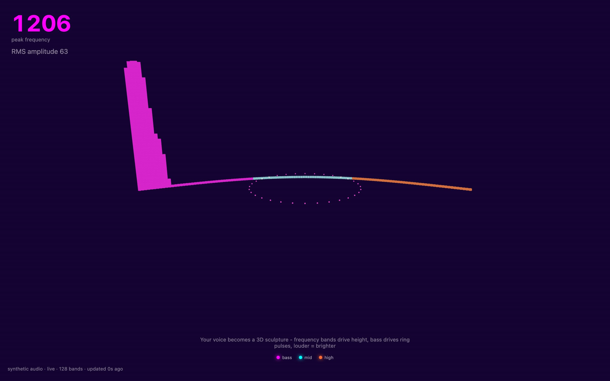

<div align="center">

<h1>echo</h1>

<p><b>Sound as a neon 3D frequency sculpture.</b></p>

<p><i>Your microphone feeds 128 glowing bars and a pulsing particle ring, in a retro synthwave scene you can orbit.</i></p>

<h6>


</h6>

<a href="https://echo.parthchandak.info"><b>Live demo</b></a> ·
<a href="#how-it-works"><b>How it works</b></a> ·
<a href="#run-it"><b>Run it</b></a>

<br><br>

<a href="https://echo.parthchandak.info"></a>

<sub>Live site, 22 October 2026, running on its built-in synthetic tone (the stamp reads "synthetic audio"), not a microphone.</sub>

</div>

<br>

echo listens through the browser's Web Audio API and turns the spectrum into geometry. Tap the
glowing button to start; the browser asks for microphone access. If you decline, or there is
no microphone, it plays its own test signal instead (a 440 Hz sine swept up and down by a slow
0.35 Hz LFO), so the scene never sits empty, and the stamp in the corner says
`synthetic audio` rather than `Microphone`. Nothing is recorded or sent anywhere.

## How it works

| Audio (AnalyserNode, FFT size 256) | Drives |
|---|---|
| Amplitude of each of the 128 frequency bins (0 to 255) | Height of that bar, eased each frame |
| Bin index | Position along a gently curved row: magenta for the lowest third, cyan for the middle, orange for the top |
| Overall RMS of the spectrum | Radius of the 32-dot particle ring |
| Average of the 16 lowest bins | Ring colour, from purple toward magenta |

The large number top-left is the frequency of the loudest bin, with the RMS amplitude under it.
Drag to orbit the sculpture and scroll to zoom. Click a bar to see its frequency and amplitude
in a small panel that closes after three seconds.

## Run it

```bash
git clone https://github.com/parthchandak02/echo.git
cd echo
npm install
npm run dev      # then open the local URL and tap the button
npm run build    # type-check, then a static site in dist/
```

Microphone access needs `localhost` or HTTPS. The live version runs on Cloudflare Pages.

<details>
<summary><b>Project layout</b></summary>

```
src/data/audioEngine.ts           Mic or synthetic source, analyser, peak and RMS
src/components/AudioReactiveField  The 128 bars and their layout
src/components/FrequencyBar.tsx    One bar: height easing, colour band, click
src/components/ParticleRing.tsx    The RMS ring and its bass-driven colour
src/components/*.tsx               Overlays: hero stats, stamp, legend, tap panel
src/store/useStore.ts              Zustand store shared by scene and overlays
brief.md                           The original creative brief
```

</details>

<br>

<div align="center">
<sub>Built with React Three Fiber, Three.js, Zustand and the Web Audio API.</sub>
</div>
